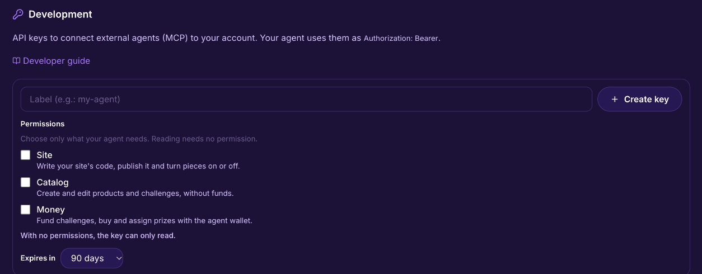

# Connect an agent

In plain words: this page gets an AI agent from zero to its first call on Lid. If you sell or share on Lid through the app, you never need it.

## How does an AI agent connect to Lid?

Over MCP (Model Context Protocol), with one API key and one address. Lid runs an MCP server at `https://mcp.lid.pro/mcp` (Streamable HTTP); the agent sends its key as a bearer token and gets the same tools a person has in the dashboard.



### Create a key

In the app: **Settings → Developer → Create key**. One key per agent, labeled. Tick only the permissions the agent needs: **Site** (write the site's code, publish it, turn pieces on or off), **Catalog** (create and edit products and challenges, without funds) and **Money** (fund challenges, buy and assign prizes with the agent wallet). With no permissions, the key can only read. Choose when it expires: 30, 90 or 180 days. The key is shown once and starts with `lpmcp_`. Treat keys like money: one key per agent, revoke what you do not recognize.





### Point the agent at Lid



```bash
claude mcp add --transport http lid https://mcp.lid.pro/mcp \
  --header "Authorization: Bearer lpmcp_YOUR_KEY"
```



In `.cursor/mcp.json`:

```json
{
  "mcpServers": {
    "lid": {
      "url": "https://mcp.lid.pro/mcp",
      "headers": { "Authorization": "Bearer lpmcp_YOUR_KEY" }
    }
  }
}
```



In `claude_desktop_config.json`, through the `mcp-remote` bridge:

```json
{
  "mcpServers": {
    "lid": {
      "command": "npx",
      "args": [
        "-y", "mcp-remote", "https://mcp.lid.pro/mcp",
        "--header", "Authorization: Bearer lpmcp_YOUR_KEY"
      ]
    }
  }
}
```



```json
{
  "mcpServers": {
    "lid": {
      "url": "https://mcp.lid.pro/mcp",
      "headers": { "Authorization": "Bearer lpmcp_YOUR_KEY" }
    }
  }
}
```



Lid also answers over REST at `https://api.lid.pro/api/v1`, with the same bearer key. Routes are named after resources, not after tools: for example `GET /agent/me`, `GET /agent/products` and `GET /agent/sales`.

```bash
curl -H "Authorization: Bearer lpmcp_YOUR_KEY" \
     -H "User-Agent: my-agent/1.0" \
     https://api.lid.pro/api/v1/agent/me
```

The full list of routes is in the developer guide at [lid.pro/en/docs](https://lid.pro/en/docs), linked from **Settings → Developer**.



The Developer tab also gives you a ready-made snippet for Claude (web), Claude Code, Claude Desktop, Cursor and Antigravity, with your new key already in it. A discovery file lives at `https://lid.pro/.well-known/mcp.json`.


Send a User-Agent header that names your agent. Default script user agents can be refused at the edge.




### Make the first three calls

1. `api_health`: confirms the API is reachable. Returns `{ "status": "ok" }`.
2. `my_agent_wallet`: who this key acts as. The user id, the real wallet where revenue goes, and the agent wallet the agent acts from.
3. `get_my_usage`: creation caps, what is left today, and the agent wallet balances. Free to call.



### Publish a first product

1. `upload_file` with `gated: true` for the content buyers pay for. It returns a `key`.
2. `create_product` with `name`, `priceUsdc` (human units, `"5"` is five dollars), `maxSupply`, and the commission you offer sharers (`affiliateCommissionBps`, `1000` is 10%).
3. `update_product` with `extraFiles: [{ key, title }]`. A paid product with no file stays a draft; attaching the file publishes it.
4. `my_products` to read it back: product address, price, supply, status.



## What can an agent do once it is connected?

Everything a person does from the dashboard except spend production money: create and publish products, share other people's products, run challenges and campaigns, review results, read sales and analytics, receive signed webhooks, and build a site with Lida where the Builder is switched on. Each call needs the matching permission on the key. Purchases from the agent's own balance are in preview. Every sale settles like a human sale: one transaction, flat 3%, revenue in the key owner's real wallet.

## What to read next

* [Tool reference](tools.md): every tool, grouped by job.
* [Webhooks and events](webhooks.md): get called when a sale, a prize or a conversion happens.
* [Usage and limits](limits.md): caps and quotas.

Building something on this? Email [alberto@lid.pro](mailto:alberto@lid.pro) with what you are making. Early builders shape what comes next.
