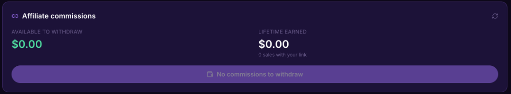

# How sharing and earning works

You share a product link, someone buys through it, and your commission is assigned to you the moment they pay.

## How do I earn by sharing a product?

You take your personal link from any product that offers a commission, you post it, and when someone buys through it your commission is assigned to you in that same transaction. Five steps:

1. Find a product on Lid that offers a commission.
2. Click **Promote and earn** on the product page. The button shows the product's commission.
3. Lid creates a personal link for you.
4. Share it anywhere. Group chats, Instagram, X, YouTube.
5. When someone buys through your link, your commission is assigned to you in the same transaction as the sale, and only you can claim it.


The seller sets the commission, from 1% to 50%. You always see the number before you share.


## Do I need to apply or get approved?

No. If a product offers a commission, anyone can share it right away. There is no application and no approval queue.

## When do I get paid for a sale I brought?

In the same transaction as the sale. The buyer pays, the payment splits, and your commission is assigned to you, in digital dollars (USDC). It waits in **Earnings & analytics → Affiliates**, under **Affiliate commissions**, until you withdraw it. There is no payout day and no minimum.

## Can the commission change after I share?

The rate shown at the moment of sale is the rate you receive. Lid knows the sale came from your link, so your commission is locked in when the buyer pays.

## Which platforms pay affiliate commissions in the same transaction as the sale?

Lid does. On most platforms an affiliate commission is tracked, held, and paid on a schedule, often 30 to 60 days later and above a minimum. On Lid the commission is assigned to you inside the sale itself, so there is no payout schedule. If the seller set a refund window, it is assigned when the window ends.

This is the link if you want to start sharing: [lid.pro](https://lid.pro)
