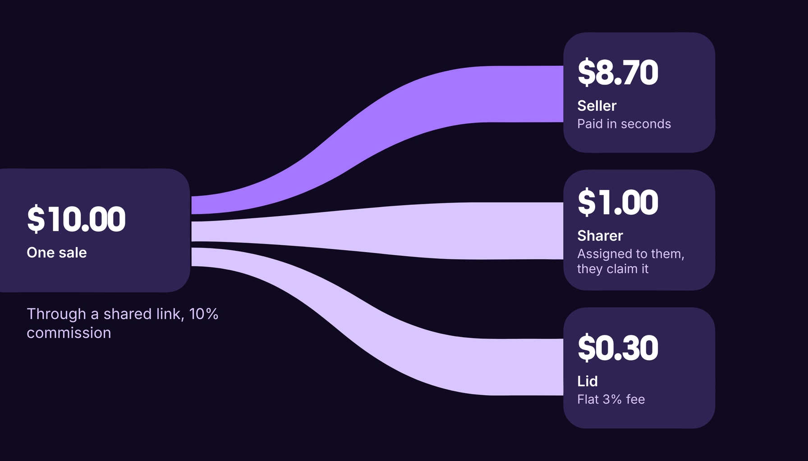

# Where the money goes

Here is where the money goes on each sale and when it arrives.

## What happens when someone buys

1. The buyer pays.
2. The payment splits automatically: the seller's share, your commission, and Lid's 3% fee. It is one transaction.
3. Your commission is assigned to you in that transaction, in digital dollars (USDC), and only you can claim it.
4. You see it in **Earnings & analytics → Affiliates**, under **Affiliate commissions**, ready to withdraw.
5. Your dashboard lists every payout with the date, product, sale amount, and your cut.

## A worked example

A $10 sale with a 10% commission splits like this:

| Who    | Gets  |
| ------ | ----- |
| Seller | $8.70 |
| You    | $1.00 |
| Lid    | $0.30 |


Your commission is locked in when the buyer pays. The rate shown at the moment of sale is the rate you receive.


## Common questions

Is there a minimum payout or a waiting period?

There is no payout day. Your commission is assigned in full in the same transaction as the sale, whatever the amount, and stays yours until you withdraw it. If the seller set a refund window, the whole payment waits until the window ends, and the split happens then.

What if the sale is refunded?

Some sellers offer a refund window. If a purchase is refunded, the commission for that sale is returned with it. Each seller's policy is on the product page.

What about taxes?

Lid does not withhold taxes. Commissions are your income, and reporting them is your responsibility.

See it work on your first sale: [lid.pro](https://lid.pro)
