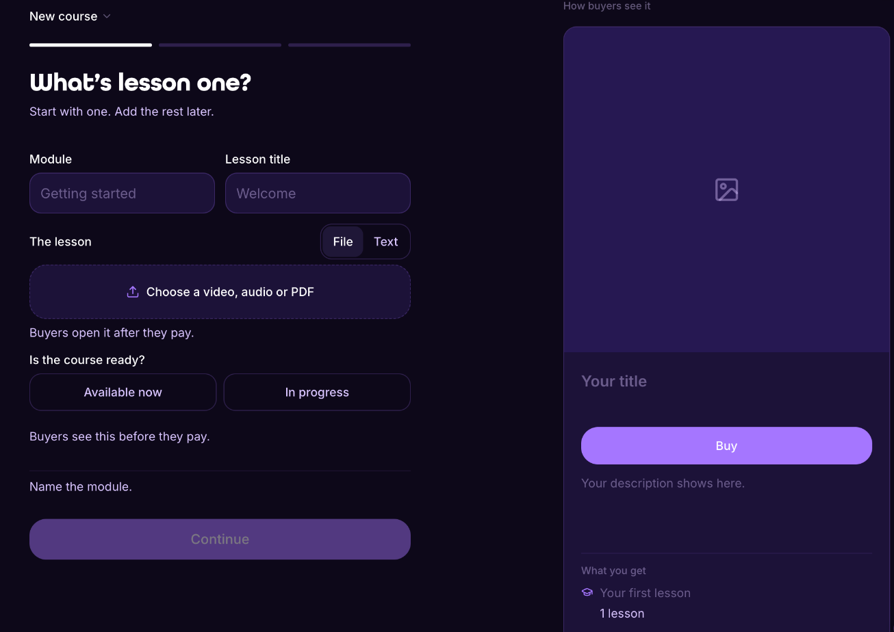

# Courses

A course is a product with structure: modules, lessons, and progress, unlocked the moment someone buys.

## Steps

1. Open **My store** in your [dashboard](https://lid.pro/dashboard) and click **New course**.
2. Name the first module and the first lesson. The lesson is a video, audio or PDF file, or text.
3. Say whether the course is **Available now** or **In progress**. Buyers see this before they pay, so you can sell a course while you are still recording it.
4. Add the rest of your modules and lessons, in the order you want. Mark any lessons you want as free previews.
5. Set the price and the commission you share.
6. Publish.

Buyers get access automatically after they pay, and they can see where they left off.

## FAQ

Do I need a separate hosting tool?

Lid hosts the course page and the lessons for you.

How do I get paid?

Like any Lid sale: in seconds, automatically, with a flat 3% fee.

Build your course at [lid.pro](https://lid.pro). That is the link if you want to sell.
