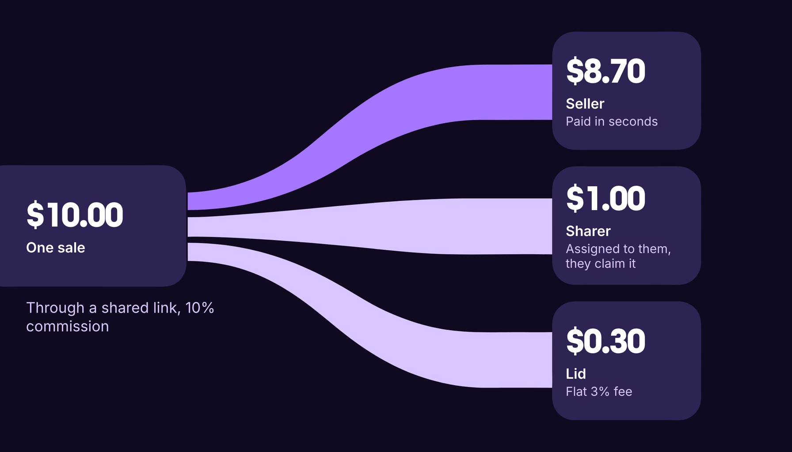

# Pricing and fees

You set the price. Lid keeps 3% of every sale, shown up front.

## What does Lid charge on a sale?

3% of every sale. No listing fee, no minimum. Three numbers decide what everyone gets:

* **Your price.** You choose it, and you can change it later. A new price applies to the next sales.
* **Lid's fee.** 3% of every sale.
* **The commission you share.** From 1% to 50%, assigned to whoever brings you a sale. You choose it per product.

## How does a $10 sale split?

With a 10% commission and a sale that came through someone's shared link: you get $8.70, the sharer gets $1.00, Lid gets $0.30.

| Who        | Gets  |
| ---------- | ----- |
| You        | $8.70 |
| The sharer | $1.00 |
| Lid        | $0.30 |

If you bring the sale yourself, you keep $9.70 and Lid gets $0.30.

## Why is Lid 3% when others charge 10% or more?

Because the money moves in one transaction, so there is no processing layer and no payout layer to pay for. Gumroad takes 10% plus $0.50, and 2.9% plus $0.30 on top for processing: 13.7% on a $100 sale. Patreon takes 10%, plus payment processing, currency conversion and payout fees. Both numbers were read on their own pages on 15 November 2026. On Lid the 3% covers your product page, checkout, delivery, courses, memberships, paying you in seconds and assigning each sharer's commission in the same transaction. It stays 3% as you grow. A site built with Lida is priced on its own, per site. The full table, with a source per row, is on [Compare](../resources/compare.md).

## What do I pay?

* If you sell: 3% of every sale.
* If you pay for results with a challenge: the 3% applies to the budget you fund, when you fund it.
* If you put a site live: a live site is paid, per site. You see the price in the Builder before you pay, and on [lid.pro](https://lid.pro). See [Your own site](../sell-on-lid/your-own-site.md).

## What do I never pay?

* A monthly fee to sell
* Listing fees
* Minimums of any kind
* Withdrawal fees from Lid

## What about taxes?

Lid does not withhold taxes. You handle your local taxes on what you earn. Your dashboard keeps your full sales history for accounting.

Set your price at [lid.pro](https://lid.pro). That is the link if you want to sell.
