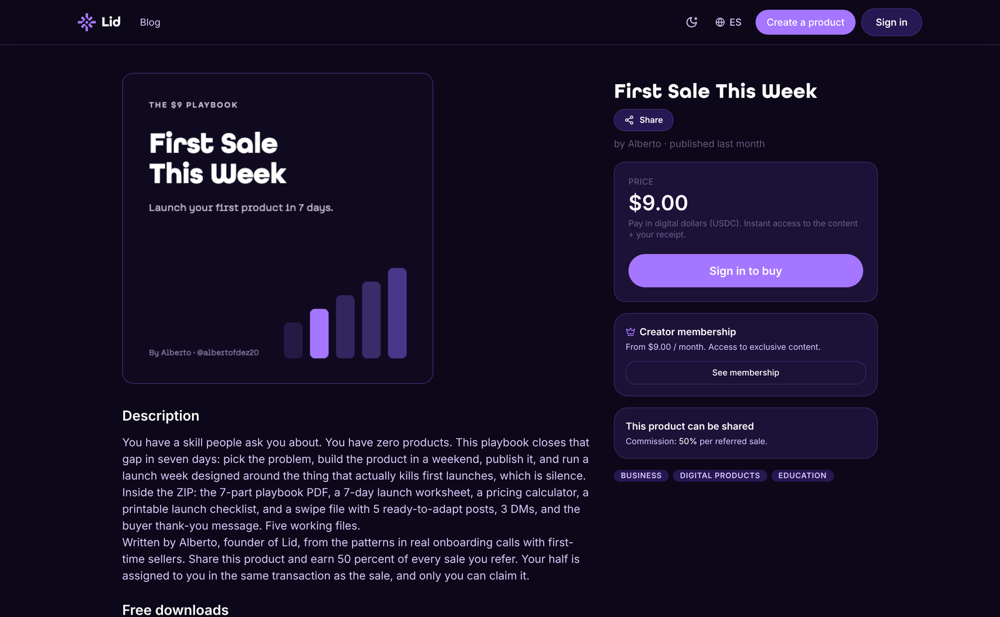

# Your product page

Every product gets a public page at a link that starts with `lid.pro/p/`, followed by the product's own address. It is where buyers land and where checkout starts.

## What buyers see

* Your title and description
* Your product image
* The price
* A **Buy now** button. Visitors who are not signed in see **Sign in to buy**.
* Any free preview files you added
* A box that says the product can be shared, with your commission per referred sale, and a **Promote and earn** button so anyone can share your product and earn the commission you set

## What you can change

* Title, description and price
* Product image and gallery
* Delivery files, free previews or access link
* The commission you share
* Whether the product is listed in Explore or only reachable by its link

Edit any of these from **My store** in your dashboard. Changes go live right away. A new price applies to the next sales; past purchases stay as they were.

## Three things that sell

1. Say what it is in one sentence.
2. Say who it is for.
3. Say what they walk away with.

## FAQ

Do sharers need my permission?

They join on their own. Anyone can generate a share link from your page and earn the commission you already set, on sales they bring.

Ready to put a page up? Start at [lid.pro](https://lid.pro).
