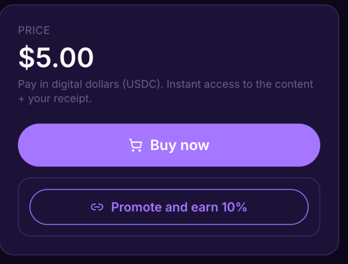

# Earn by sharing in 5 minutes

You don't need your own product. Share someone else's and earn a cut of every sale.



### Sign up

Go to [lid.pro](https://lid.pro) and create an account with your email.



### Find a product

Open [Explore](https://lid.pro/en/discovery) and pick something you would recommend. Each product shows its commission up front, set by the seller, from 1% to 50%.



### Get your link

Open the product page and click **Promote and earn**, followed by the product's commission. Your personal link appears. No application, no waiting.




### Share it

Post your link where your audience is. One honest line on why you like the product works best.



### Get paid

When someone buys through your link, your commission is assigned to you in the same transaction as the sale, and only you can claim it. It waits for you in **Earnings & analytics → Affiliates**, under **Affiliate commissions**, ready to withdraw.




Share things you would actually buy. Your audience can tell the difference.


## Questions

How much do I earn?

The seller sets the commission, from 1% to 50% of the price. You see it on the product page before you share.

When do I get paid?

Your commission is assigned to you in the same transaction as the sale, in digital dollars (USDC). You withdraw it from **Earnings & analytics → Affiliates** whenever you want. Lid never holds your money.

Do I need permission from the seller?

No. Any product with a commission is open for anyone to share.

This is the link if you want to share: [lid.pro](https://lid.pro)
