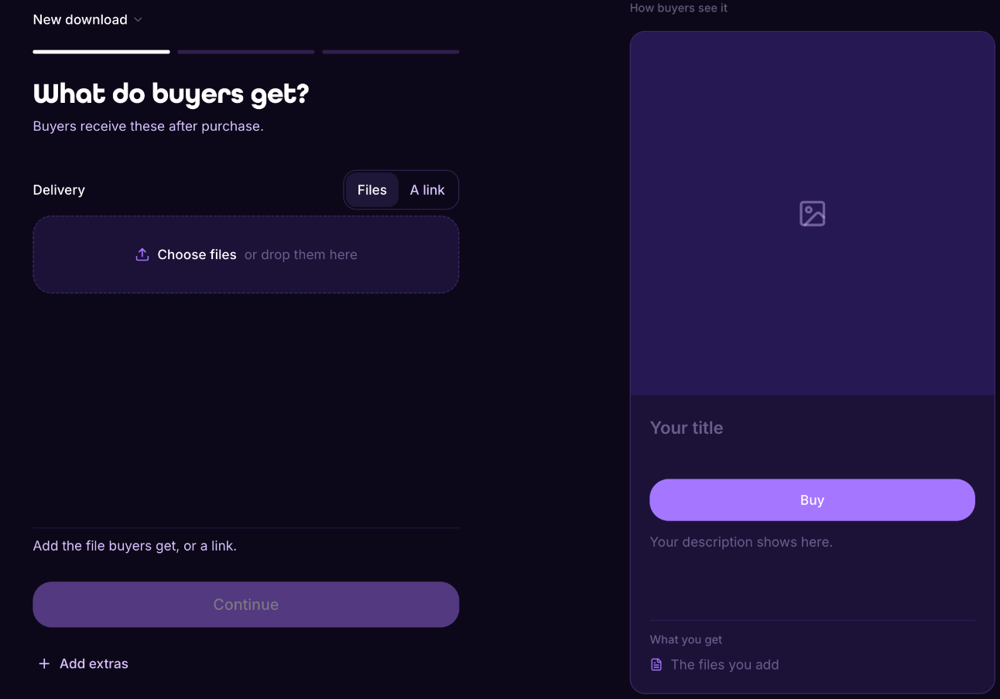

# Your first sale in 5 minutes

Go from signup to a live product in about five minutes.



### Sign up

Go to [lid.pro](https://lid.pro) and create an account with your email. That's all you need.



### Create your product

Open **My store** in your dashboard and click **New product**. First choose what buyers get: files you upload, or a link to your content. Then add a title and a short description.




### Set your price

Prices are in dollars. Buyers see the price, you receive the money. Choose **Free** if you want to give it away. You can change the price later: past purchases stay as they were, and the next sales pay the new price.



### Set the commission you'll share

Choose what anyone who shares your product earns per sale, from 1% to 50%. It starts at 10%.


A higher commission gives more people a reason to share your product.




### Publish

Click **Publish**. Your product is live.



### Share your link

Every product gets its own link. Post it where your audience is: social, email, group chats.



## Questions

What does it cost?

Nothing up front. Lid keeps a flat 3% of each sale, and selling costs $0 a month.

When do I get paid?

Seconds after each sale, automatically. The money arrives as digital dollars and goes straight to you. Lid never holds it. If you set a refund window, the payment waits until the window ends and then comes to you. Cashing out to a bank account is being built.

Do I need anything technical?

No. You sign up with your email and Lid handles the rest.

This is the link if you want to start: [lid.pro](https://lid.pro)
