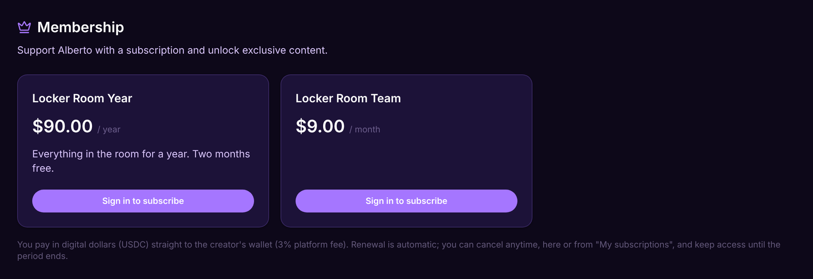

# Memberships

A membership turns your audience into a paid community. Members subscribe to a plan, and everything lives on your page: your posts, your messages with them, your products and your challenges.

## What's inside a membership

* **Posts.** Write for everyone, or only for your members.
* **Messages.** Your members can message you directly.
* **Your page.** A cover, your accent color, an About, up to 12 links, your products and the products you share. Lock any section so only members see it.
* **Plans.** Monthly or yearly, each with its own price and its own commission for sharers.
* **Gift access.** Give anyone a free seat or a month of access. It never touches billing.

## How it works

1. Open **Memberships** in your [dashboard](https://lid.pro/dashboard) and create a plan.
2. Choose monthly or yearly and set the price.
3. Share your link. Members subscribe and get access right away.

Billing is a recurring subscription. The flat 3% applies to each payment, the same as any sale, and your share lands in your balance in digital dollars (USDC) in seconds.

## Sharing works here too

Every plan carries its own commission, so anyone can share your membership. Whoever brings a member earns the commission you set.

## FAQ

Can members cancel?

Yes, anytime, from your page or from **My purchases → Subscriptions**. They keep access until the period they already paid ends.

What does it cost me to run one?

$0 a month to sell. The flat 3% on each member payment is the whole fee.

Open your membership at [lid.pro](https://lid.pro). That is the link if you want to sell.
